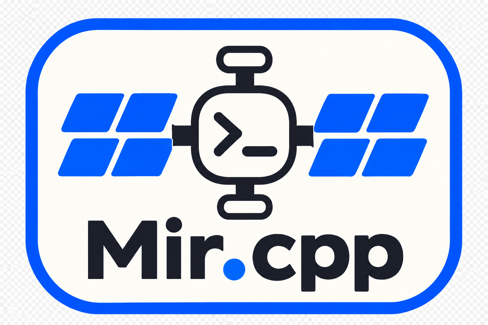
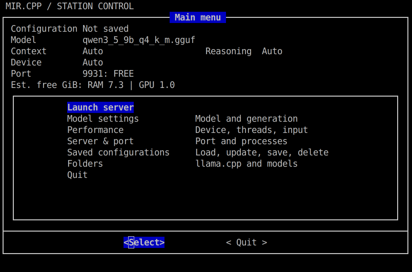
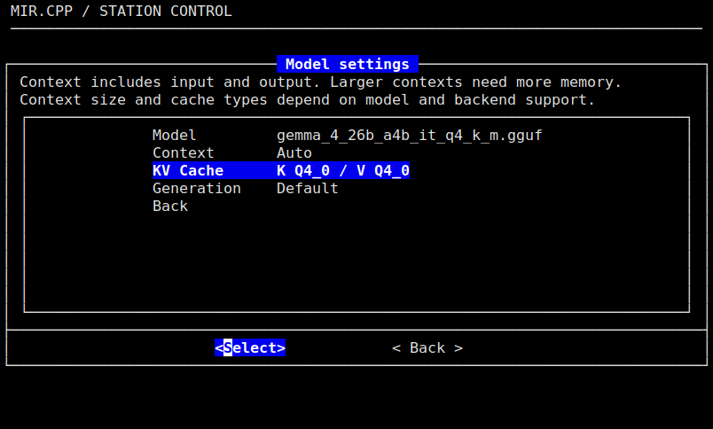

<p align="center">
  
</p>

# Mir.cpp

Run local GGUF models with llama.cpp through a terminal menu on Linux and macOS.
Choose a model, adjust its settings, save configurations and chat in your browser.
Mir.cpp supports Linux with CPU, Vulkan and CUDA builds, and macOS with CPU and Metal.
CUDA still needs validation on NVIDIA hardware. The name comes from the Mir space station.

[](mir/docs/screenshots/main-menu.png)

*Review your model and server settings before launching.*

## Requirements

- Linux or macOS, internet access and a terminal.
- On Linux: Bash 4.4 or newer, curl and working HTTPS certificates to start
  the installer. Ubuntu/Debian dependency installation is assisted; other
  distributions require equivalent packages installed manually.
- On macOS: [Homebrew](https://brew.sh/). The installer starts with the system
  Bash and offers to install compatible Bash and missing launcher dependencies.
- At least one GGUF model supported by llama.cpp, with enough RAM or GPU memory.
  Model downloads and GPU drivers are configured separately.

The installer asks before installing missing dependencies through apt on
Ubuntu/Debian or Homebrew on macOS. Only apt operations may require sudo.
Install llama.cpp from **Folders → Install / update llama.cpp**, or select an
existing build. macOS compilation also requires Apple's command line tools.
See the [official llama.cpp build instructions](https://github.com/ggml-org/llama.cpp/blob/master/docs/build.md)
for platform and GPU requirements.

## Quick install

```bash
curl -fsSL https://raw.githubusercontent.com/etufarini/Mir.cpp/main/mir/sh/install.sh | bash
```

Installs for your user in `~/.local/share/mir.cpp/` and creates
`~/.local/bin/mir`. Close the launcher and run the same command again to update.

## Start

```bash
mir
```

If the command is not found, use `~/.local/bin/mir` or add `~/.local/bin` to your PATH.

1. Open **Folders → Install / update llama.cpp** to build CPU/Vulkan/CUDA on Linux
   or CPU/Metal on macOS. You can also select an existing **llama.cpp folder**.
2. Choose your **Models folder** in **Folders**. Models can be organized in subfolders.
3. Choose a GGUF from **Model settings → Model**, then review the settings.
   Start with **Auto** and **Default** values; KV Cache defaults to **Q4_0** for K and V.
4. Select **Launch server**. The browser opens when ready, normally at
   `http://127.0.0.1:9931`. Keep the terminal open while chatting.

[](mir/docs/screenshots/model-settings.png)

*Choose a supported context size and cache type. Larger contexts need more memory.*

Terminal settings configure the server; browser chat settings can override generation defaults.
Use **View log** if loading fails and **Stop server** when finished. Closing the browser
leaves the server running. If the port is **IN USE**, choose another port or inspect
**Server & port**. Stopping another process requires confirmation; forcing it to stop
requires a separate confirmation.

Update llama.cpp through **Folders → Install / update llama.cpp → Check for updates**.
Failed builds keep the working version; **Restore previous build** switches back.

To remove Mir.cpp, stop the server, close the launcher and run `mir --uninstall`.
Confirm when prompted. Models, llama.cpp and saved configurations are kept.

See the [user guide](mir/docs/guide.md) for dependencies, saved configurations,
advanced settings, troubleshooting and maintenance.
