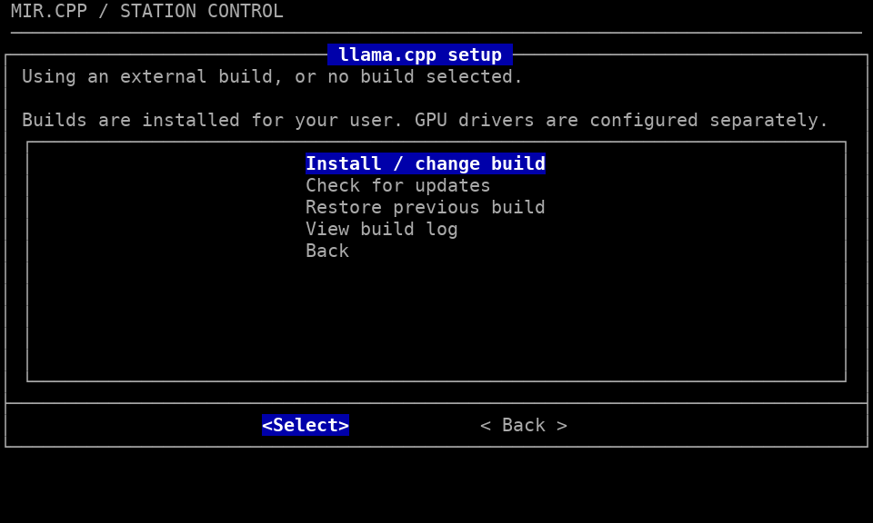

# Mir.cpp user guide

For requirements, installation and first launch, see the [README](../../README.md).
This guide covers optional settings, maintenance and development checks.

The launcher supports Linux with CPU, Vulkan and CUDA builds of llama.cpp,
and macOS with CPU and Metal builds. CUDA hardware validation on NVIDIA is
still pending. The backend and available devices come from your llama.cpp
build; **Performance → Device** lists the detected devices.

Native smoke checks on Apple M4 passed with Auto, CPU only and explicit Metal,
using the small `stories260K.gguf` fixture: server health, Web UI access,
completion generation and shutdown. This does not establish performance,
large-model capacity or validation on Intel Macs.

To run from a source checkout, keep the `mir/` folder together and run
`bash mir/mir.sh` from the repository root. The installer is at
`mir/sh/install.sh`; the installed command is `mir`.

## Update or remove

Program files are installed in `~/.local/share/mir.cpp/`, or `$XDG_DATA_HOME/mir.cpp/` when set. The command remains `~/.local/bin/mir`.

The curl installer offers to install missing launcher dependencies on Ubuntu/Debian. It uses `apt-get update` and installs the required packages, without a system-wide upgrade or package removals. Confirmation and sudo authentication use the terminal even when the script arrives through a pipe. Only package-manager commands run with elevated privileges; Mir.cpp and llama.cpp are installed and compiled as your user. Without a terminal, missing dependencies produce installation instructions and stop the installer. Declining or failing this step keeps the existing launcher installation.

Launcher packages include Bash, curl, CA certificates, coreutils, findutils, grep, util-linux, tar, gzip, dialog, iproute2, procps and xdg-utils. To install them manually on Ubuntu/Debian:

```bash
sudo apt-get update
sudo apt-get install bash curl ca-certificates coreutils findutils grep util-linux tar gzip dialog iproute2 procps xdg-utils
```

Other Linux distributions can use existing tools, but automatic package installation is limited to Ubuntu/Debian and compatible derivatives. The initial curl command itself needs curl, Bash and working HTTPS certificates already available. Python 3 remains optional for launcher model filtering; the build workflow installs it for release metadata parsing.

Run the same curl installation command again to update or reinstall a clean copy of the program. Downloads are checked in a temporary folder before activation; failed downloads, missing files or invalid Bash syntax keep the previous installation active. After successful activation, old installer-managed copies and interrupted staging folders under `releases/` are removed. A cleanup permission error is reported as a warning while the new copy remains active. Missing or damaged wrappers carrying the Mir.cpp ownership marker are recreated. An unrelated existing `~/.local/bin/mir` command is never overwritten.

Updates preserve model files, llama.cpp and saved settings. Settings use `~/.config/mir.cpp/` (or under `XDG_CONFIG_HOME`). On first launch, legacy settings are imported atomically when the Mir.cpp folder is absent. Originals and previous installations are preserved; existing Mir.cpp settings are never merged or overwritten. Import failures stop startup with a clear error so you can correct permissions and retry. Close the launcher before updating.

To remove the installed launcher and its downloaded releases, stop the server,
close the launcher, then run:

```bash
mir --uninstall
```

Confirm with `y` or `yes`; Enter cancels. Without a terminal, use
`mir --uninstall --yes`. If `mir` is not on your PATH, use
`~/.local/bin/mir --uninstall`. Older installations need one update first to gain
this command. Removal uses the paths recorded at installation, even if HOME or
XDG variables have since changed. It keeps models, llama.cpp, saved settings,
previous installations, and unrelated files and symlinks outside
installer-managed release directories. The command must still carry its Mir.cpp
ownership marker and target this installation. Unrecognized or replaced files
are refused. Removal does not stop a running launcher or server for you.

Installation and removal share a lock; concurrent operations are rejected with
a clear message. The lock is released automatically on exit, including after a
forced interruption. The small `.install.flock` file and containing directories
remain after removal so concurrent operations always use the same lock; they do
not prevent reinstallation. Unrelated files are left in place. Legacy
`.install.lock` directories are ignored. The installer and uninstaller use
`flock` from `util-linux` on Linux or Homebrew on macOS. GNU `mv` and `find`
(`gmv` and `gfind` on macOS) preserve activation and discovery semantics. Permission failures are reported without
sudo; correct the permissions and retry, or reinstall to repair a partial removal.

On macOS, a Bash 3.2-compatible bootstrap finds Homebrew through `brew --prefix` or its standard Apple Silicon/Intel locations, then selects Bash 4.4 or newer before loading modules. It appends the Homebrew bin directory to PATH only inside the launcher/installer process and its children, preserving existing command precedence. It never edits shell configuration or changes the login shell.

This works for source startup, `curl | bash` installation and the installed command, even when `/bin/bash` is selected first. The installed wrapper uses the compatible Bash interpreter selected by the installer. If Bash or another required dependency is missing, install the packages shown in the error and retry the same command. Homebrew itself remains a prerequisite on macOS; the launcher does not install it or other packages automatically.

## Using the menu

Use the arrow keys to highlight an item, **Enter** or **Select** to open it, and **Tab** to move between buttons. Menus offer **Select / Back**; the main screen offers **Select / Quit**. Cancel an individual setting with **Back** or **Esc** to keep its previous value. **Quit** or **Esc** on the main screen exits the launcher.

The main screen shows the current configuration and model, context and reasoning on one line, then device, port status and estimated free memory. Long names are shortened in summaries, keeping their beginning and end; stored values are unchanged. Launch server is first; setup and management menus follow. Internal menu codes are hidden to keep the display clear at 80×24 characters. It has seven entries:

| Menu | What it contains |
| --- | --- |
| Launch server | Start the model with the settings shown above. |
| Model settings | Select the GGUF model, context, reasoning and generation settings. |
| Performance | Adjust device, CPU threads, GPU layers and prompt processing. |
| Server & port | Choose the port, refresh its status, view process details or stop its listeners. |
| Saved configurations | Load, save, update or delete named groups of settings. |
| Folders | Install/update llama.cpp, restore a build, or select llama.cpp and models folders. |
| Quit | Exit the launcher. |

Menus remember the selected entry when you return from an option. Setting selectors highlight the current value when available and use specific screen titles. Each submenu puts its settings and actions before Back. Use **Back** or **Esc** to return from a submenu. Start with **Auto** context and reasoning in **Model settings**. In **Server & port**, the default port is `9931`.

**Auto** context omits the context argument, allowing llama.cpp's native model, environment and memory choices. Fixed choices run from 4K to 256K; **Custom** also accepts smaller contexts, from 1 to 2147483647 tokens. Custom `0` explicitly requests the full model context and can require much more memory than Auto. Not every model supports every size or reasoning mode; automatic fitting is not a guarantee that a model will fit in RAM or GPU memory. Existing profiles keep their saved context.

After you select **Launch server**, loading may take a while. The browser opens when the server is ready. If it does not open, visit the displayed address (normally `http://127.0.0.1:9931`).

The running screen offers **View log** for details and **Stop server** to stop the model and exit. Closing the browser alone does not stop the server. Logs are temporary and are removed when the launcher exits.

The interface follows the Mir.cpp logo palette: a black background, light text, white-on-blue titles, selected items and active buttons, and thin light borders without shadows. A compact MIR.CPP / STATION CONTROL header identifies every screen once; window titles describe the current task, such as **Main menu**, **Model settings** or **Server log**. Aligned summaries separate configuration, model settings and server status, with consistent spacing throughout. Keep the `lib/` folder and `dialogrc` beside the script when moving the launcher; the theme applies only to this launcher. Exact shades and the monospaced font follow your terminal settings; the launcher does not redefine the terminal palette or change fonts. Status labels remain explicit without color, and the menus fit an 80×24 terminal. Dialog windows use the actual terminal dimensions and recenter when resized. Mir.cpp ignores inherited `LINES`, `COLUMNS` and `DIALOGOPTS` only inside dialog invocations, so stale sizes or external positioning options cannot shift its menus; the caller's environment is preserved.


## Folder paths

Open **Folders** to change **llama.cpp folder**, **Models folder**, or open **Install / update llama.cpp**. For an existing build or models folder, the browser shows the current path, folder actions first and alphabetically sorted directories below. The Select button runs the highlighted action or opens the highlighted directory. Use **Up/Down** and **Enter** to open a folder; **Parent folder** goes up one level. Choose **Use this folder** to confirm the current folder. **Back** or **Esc** cancels without changing the saved path.

Hidden folders are excluded initially; **Show hidden folders** reveals them, and **Hide hidden folders** hides them again. Use **Enter path** to paste or type a path, including a hidden folder. Spaces and `~/` are supported. Entering a path navigates there; choose **Use this folder** afterward to save it.

Select the main llama.cpp folder: it must contain executable `build/bin/llama-server` (source builds) or `bin/llama-server` (package layouts). When both exist, the source build takes precedence. For Homebrew llama.cpp, select the directory printed by `brew --prefix llama.cpp`. The models folder is searched recursively. Changing it refreshes the model list immediately and keeps the selected model if it is still listed; otherwise the first available model is selected. Empty folders are accepted with a message; add GGUF files and select the folder again to refresh.

Links to model files and to the selected root folder work; discovery does not descend through linked subfolders. When Python 3 is available, a bounded metadata reader omits recognized multimodal projectors, adapters and later parts of split models. Select the first part, keeping the other parts alongside it. Unknown formats and unreadable metadata stay listed so the installed llama.cpp can decide whether they work. Python is optional; without it, all discovered GGUF files are shown.

Valid changes are saved automatically in `~/.config/mir.cpp/paths.conf` (or under `XDG_CONFIG_HOME`). These paths apply to all profiles and direct startup, separately from named model configurations. If a folder moves, reopen **Folders** to correct it. Missing paths or an empty model list do not close the menu; launching requires an executable server and an existing selected model.

## Build and update llama.cpp

Open **Folders → Install / update llama.cpp → Install / change build** and choose CPU, Vulkan or CUDA. Managed builds currently target Linux; on macOS, select an existing CPU/Metal build in Folders. CUDA integration still needs validation on NVIDIA hardware. External builds and other llama.cpp backends remain supported through folder selection and the existing device controls.



*The setup menu in a real 80×24 terminal, before selecting a managed build.*

The setup installs missing build dependencies when you approve: Git, CMake, Make and C/C++ compilers, Python 3, util-linux, coreutils, and OpenSSL/curl development libraries. Vulkan adds `libvulkan-dev`, `glslc`, `spirv-headers`, `vulkan-tools` and Mesa Vulkan drivers on Ubuntu/Debian. CUDA uses an existing `nvcc`, otherwise it installs `cuda-toolkit` from an already configured NVIDIA repository when available, or the distribution's `nvidia-cuda-toolkit`. Package availability and compiler/toolkit compatibility vary by distribution version; configure the appropriate repositories if installation fails. The setup does not add third-party repositories, replace kernel GPU drivers or reboot your system. Follow the [official llama.cpp build instructions](https://github.com/ggml-org/llama.cpp/blob/master/docs/build.md) for platform requirements and the [NVIDIA installation guide](https://docs.nvidia.com/cuda/cuda-installation-guide-linux/) for CUDA/driver compatibility.

When packages are missing, the menu temporarily gives way to a cleared terminal for the `y/N` confirmation, sudo password and installation output. Press **Enter** when finished, including after an error or cancellation, to return to the redrawn TUI. If all dependencies are already available, the menu continues without this extra step.

Choose **Latest published release** or enter a **Specific release tag**. The latest choice includes published pre-releases, which are labeled as such upstream; it is not a promise of stability. Tags are resolved to a recorded commit. Mir.cpp clones only the requested upstream version and compiles it in a new directory. Modern versions use the Web UI archive published with that exact release, verified against its SHA-256 digest. Missing or mismatched assets block the build; there is no fallback to a newer UI. Older versions with bundled Web UI assets use those directly. Choose 1–64 parallel compiler jobs (default 2); higher values use more RAM and do not change inference thread settings. The build screen offers **View log** and **Cancel build**, with confirmation before cancellation. Escape also offers cancellation. A lock prevents simultaneous managed builds.

Builds live under `${XDG_DATA_HOME:-$HOME/.local/share}/mir.cpp/llama.cpp/builds/`, separate from launcher releases. Each has its source, build tree and plain `mir-build.conf` metadata. Before selecting it, Mir.cpp checks the executable's version/help, device discovery and Web UI assets. GPU builds require an available accelerator. The optional `llama-fit-params` memory planner is built when supplied by upstream. Modern Web UI assets are downloaded before compilation; missing assets prevent activation. These checks do not prove that every GGUF model or context fits or works; actual loading remains llama.cpp's responsibility.

**Check for updates** shows the latest published tag and asks before building with the selected managed backend. Updates keep the same backend; **Install / change build** changes it or selects a particular version. A successful build saves its path atomically for the TUI and direct startup. Model settings, saved profiles, browser preferences and external installations are preserved. Failed or canceled builds keep the previously selected path. **Restore previous build** selects the preceding managed build after confirmation, without needing network access or recompilation. Updates do not modify external source trees; select a Mir.cpp-managed build to use this workflow.

**View build log** opens the latest attempt's log, kept at `llama.cpp/build.log` until the next attempt. Completed builds are retained for recovery and consume disk space; failed builds are removed. Keep builds referenced by saved paths or running sessions when cleaning disk space. Updating or removing Mir.cpp preserves llama.cpp builds and system dependency packages; dependencies are not automatically uninstalled. Use the same `XDG_DATA_HOME` to manage previously installed builds.

## Performance settings

The main screen uses one compact line, for example `Est. free GiB: RAM 16.3 | GPU 1.5`. Negative values indicate missing memory. `N/A` means unknown; `+N` means more pools are available through the **Next memory** button, shown only when needed. The line is limited to the space inside the box. All seven main menu actions are visible at 80×24. Estimates include model weights, context/state and compute buffers, using `llama-fit-params` beside your server. On Linux, the planner and GNU `timeout` are optional: if unavailable or unsupported, the launcher says **Est. free: unavailable** and still allows startup. No model is loaded for inference to produce the estimate.

On macOS the same compact format shows one approximate system-memory value: **Est. free GiB: RAM ~8.2** before launch and **Free GiB: RAM ~7.9** while running (example values). The live figure is the RAM currently available for other workloads after loading, including inactive pages that may be reclaimed. It is refreshed from native `vm_stat` free, inactive and speculative counts using its actual page size, following [psutil's available-memory calculation](https://github.com/giampaolo/psutil/blob/master/psutil/arch/osx/mem.c). It is an approximation, not an exact equivalent of Linux MemAvailable or a guarantee against swapping. No extra packages or privileges are required for the measurement.

On Apple Silicon, native CPU and Metal share physical memory. The prelaunch forecast subtracts the planner's model, context/state and compute allocations from available RAM once, without presenting a separate GPU balance. On other Macs, a CPU-only plan can be subtracted from system RAM; plans with separate accelerator allocations show **N/A** because that GPU memory cannot be treated as RAM. Missing or unsupported planner output also gives **N/A** before launch; the live RAM reading remains independent. Forecasts require matching server slots and KV-cache layout. For example, an older planner without unified KV support cannot estimate a server that enables it automatically, so the forecast remains unavailable instead of using a different layout. Native slot and KV environment overrides are checked too. Metal device probes are not used as free-memory measurements. RSS, pressure, swap, total RAM and device budgets are omitted from this compact line.

On Linux the existing **Est. free GiB** and **Free GiB** presentation is retained, using available system RAM and device reports. All forecasts are advisory: reclaimable pages, automatic placement, memory-mapped weights, server slot/KV layouts, runtime overhead, multimodal projectors and explicit extra arguments can differ from the planner. Estimates refresh after configuration changes; startup retains llama.cpp's own automatic choices. No CPU/GPU utilization percentages, conversation recording or telemetry uploads are added.

Open **Performance** to adapt the launcher to another computer. Start with **Auto** and **Default**: these use llama.cpp's own choices, without fixed thread counts or a specific GPU.

| Option | Choices and advice |
| --- | --- |
| Device | **Auto**, **CPU only**, or a device detected by your installed llama.cpp. CPU only disables GPU layers. |
| CPU threads | **auto** or a positive number. Try a few values: using more threads is not always faster. |
| GPU layers | **auto**, **all**, or a number starting at 0. Auto lets llama.cpp fit layers to device memory; all can exceed it. The menu shows **Ignored (CPU only)** when it does not apply; the chosen layer count is kept for other devices. |
| Prompt processing | **Default**, **Low memory**, or **Large batch**. Low memory processes smaller chunks of input; Large batch tries larger chunks and needs more memory. |

Larger batches mainly affect how quickly input text is processed; they do not guarantee faster answer generation. On integrated graphics, the CPU and GPU share memory, so more GPU use is not always better. Flash Attention remains on llama.cpp's automatic setting.

Change one setting at a time and compare the same model, context and input. If loading fails, return to Auto/Default or reduce the context. To keep your choices after exit, save them under **Saved configurations**.

Before launch, the launcher checks requested options against the installed server's help and checks explicit devices when discovery succeeds. Missing options or devices produce a message; the TUI stays open for correction. A profile from another computer is not silently rewritten. Help and device probes have 15-second time limits, including cold Metal initialization; if GNU `timeout` (`gtimeout` on macOS) is absent, they are skipped and llama.cpp reports startup errors itself. Auto and CPU only remain available in the device menu.

## Generation settings

Open **Model settings → Generation → Preset** to choose how text is sampled. Start with **Default**, which leaves llama.cpp's native settings and environment defaults unchanged. The other presets are starting points to compare on your model, not promises of accuracy or creativity. Follow the model author's recommendations when available.

| Preset | Temperature | Top-P | Top-K | Min-P |
| --- | --- | --- | --- | --- |
| Default | Native defaults | Native defaults | Native defaults | Native defaults |
| Focused | 0.6 | 0.95 | 20 | 0 |
| Exploratory | 1 | 0.95 | 20 | 0 |
| Min-P | 1 | 1 (disabled) | 0 (disabled) | 0.05 |
| Custom | Edit individual values | | | |

Presets are manual starting points for supported models; no model is detected or assigned a preset automatically. Explicit presets set repeat penalty to **1** and presence/frequency penalties to **0**, disabling those penalties. Presets do not change context, reasoning, hardware settings, seed or output length.

**Sampling parameters** shows all seven sampling values and lets you adjust them separately. Temperature controls randomness; Top-P, Top-K and Min-P filter token choices. Lower temperature does not guarantee correct answers. Penalties can reduce repetition but can also harm useful repeated text. Enter **auto** to leave a field to llama.cpp. Decimal inputs use a dot, a leading digit and at most nine decimal places. The preset label follows the exact sampling values; other combinations show **Custom**.

**Seed** accepts **auto**, **-1** for random, or an integer from **0** to **4294967295** (which also selects random). A fixed seed helps comparisons but does not guarantee identical results across runs, hardware or other settings. **Maximum output tokens** accepts **auto**, **-1** for no fixed generation limit, or **0–2147483647**; zero evaluates input without generating an answer. This is separate from context capacity. A short output limit can cut off reasoning before the answer.

These settings are **server defaults**. Explicit settings saved in your browser chat or sent by another client can override them. In the browser's generation settings, clear custom sampling values to use the server defaults; the launcher does not change browser preferences or conversations. Changes in the terminal take effect when you launch the server. If your llama.cpp build rejects an option, check **View log**, update llama.cpp or return that field to **auto**.

## Saved configurations

Choose your model and settings, then open **Saved configurations → Save as new configuration** and enter a name, such as `Gemma 8K` or `Qwen CPU`. Use **Load configuration** to restore a saved configuration, review its settings in the main menu, and select **Launch server** when ready. Loading does not start a server. **Delete configuration** removes a saved configuration; replacing or deleting one asks for confirmation.

Each configuration stores the model path, context, reasoning, port, all four Performance settings and all nine generation values, including seed and maximum output tokens. Older profiles without generation settings still load, restoring generation values to **auto**. New profiles require the complete set of fields; invalid or incomplete files leave all current settings unchanged. Profiles saved by this version require this version or newer to load. Conversations, extra command-line arguments and environment settings outside these menu controls are not saved. The main screen and Saved configurations menu show the current configuration name, or **Not saved**. Loading or saving a profile makes it current. Changes to its settings add **(Modified)**; restoring the saved values clears that marker. Choose **Update current** to overwrite the current profile after confirmation, or **Save as new configuration** to create another one. Nothing is saved automatically. Deleting the current profile keeps your settings and changes the label to **Not saved**. The current profile is tracked only for the open launcher session. Global folder paths are stored separately and are not compared; changing the models folder can still mark a profile Modified if it changes the selected model.

Files are stored in `~/.config/mir.cpp/profiles/` (or under `XDG_CONFIG_HOME` when set). You can back up that folder. If a model has moved or a profile is incomplete or invalid, loading leaves your current settings unchanged. A saved device must still be supported by your computer; choose Auto or CPU only after loading if needed. The launcher checks the selected port again before startup.

## If the port is already occupied

The main menu shows **IN USE**. Open **Server & port → View process details** to see process IDs, owners and names when available. Use **Up/Down** to scroll through long lists; **Back** or **Esc** returns to the port menu.

Choose another port, or open **Server & port → Stop process using port**. Check the displayed processes before confirming: they may belong to another application. Both shutdown confirmations include process details; use **Up/Down** to scroll if needed. The launcher first requests a normal shutdown. If a process stays active, it asks for a separate confirmation before forcing it to stop.

The launcher cannot stop processes owned by another user without the necessary permissions. If process details are unavailable, choose another port. Startup is blocked while the selected port is occupied.

## Advanced command-line use

Start with `mir` and configure folders, discovered models and settings in the TUI.
The commands below are optional shortcuts for automation and advanced server options.

Optionally override saved folders for an invocation with `MIR_LLAMA_CPP_DIR` and `MIR_MODELS_DIR`. Choosing a folder in Folders saves the currently displayed paths:

```bash
MIR_LLAMA_CPP_DIR="/path/to/llama.cpp" MIR_MODELS_DIR="/path/to/models" ~/.local/bin/mir
```

Start a specific model directly, without the menu:

```bash
MIR_CTX_SIZE=8192 MIR_REASONING=auto MIR_PORT=9931 \
    ~/.local/bin/mir "/path/to/model.gguf"
```

Performance settings also work with direct startup. For example, use only the CPU, four threads and smaller input chunks:

```bash
MIR_DEVICE=none MIR_THREADS=4 MIR_PROMPT_PROCESSING=low-memory \
    ~/.local/bin/mir "/path/to/model.gguf"
```

The optional variables are `MIR_CTX_SIZE` (`auto`, `0` for full model context, or a positive token count), `MIR_DEVICE` (`auto`, `none`, or comma-separated device names such as `Vulkan0,Vulkan1`), `MIR_THREADS` (`auto` or a positive number), `MIR_GPU_LAYERS` (`auto`, `all`, or a nonnegative number), and `MIR_PROMPT_PROCESSING` (`auto`, `low-memory`, or `large-batch`). Defaults leave the corresponding llama.cpp arguments unset, so any native llama.cpp environment settings still apply. Explicit arguments after the model path are passed through to llama.cpp and can override launcher choices. Multi-device selections are preserved in profiles too.

For model capabilities beyond the chat menus, pass the installed server's options directly: for example `mir /path/to/model.gguf --mmproj /path/to/projector.gguf`, or `--embedding` / `--rerank` with a suitable model. These components and task options are not saved in launcher profiles. Follow the model author's template and component requirements; the launcher does not infer them from model names.

Generation presets and individual overrides also work for direct startup:

```bash
MIR_GENERATION_PRESET=focused MIR_TEMPERATURE=0.7 MIR_MAX_TOKENS=2048 \
    ~/.local/bin/mir "/path/to/model.gguf"
```

`MIR_GENERATION_PRESET` accepts `default`, `focused`, `exploratory` or `min-p`. Individual controls override that preset: `MIR_TEMPERATURE`, `MIR_TOP_P`, `MIR_TOP_K`, `MIR_MIN_P`, `MIR_REPEAT_PENALTY`, `MIR_PRESENCE_PENALTY`, `MIR_FREQUENCY_PENALTY`, `MIR_SEED` and `MIR_MAX_TOKENS`. Each accepts `auto` or a numeric value as described above; temperature must be nonnegative, Top-P/Min-P must be in 0–1, Top-K a nonnegative integer up to 2147483647, and repeat penalty positive. Presence and frequency penalties allow signed decimals. Native llama.cpp environment defaults apply where a field is `auto`; explicit trailing arguments still take precedence.

Stop a direct session with **Ctrl+C**. Direct startup reports an occupied port and exits; use the menu to manage the occupying process.

Previous launcher controls remain compatibility aliases. The older `LLAMA_CPP_DIR`, `LLAMA_MODELS_DIR`, `LLAMA_CTX_SIZE`, `LLAMA_REASONING`, `LLAMA_PORT`, `LLAMA_DEVICE`, `LLAMA_THREADS`, `LLAMA_GPU_LAYERS`, `LLAMA_PROMPT_PROCESSING`, `LLAMA_HOST` and generation aliases remain supported too. `LLAMA_CPP_DIR` maps to `MIR_LLAMA_CPP_DIR`.

For each setting, explicitly set `MIR_*` values take precedence over previous launcher aliases, which take precedence over `LLAMA_*`. Explicitly empty `MIR_*` values and previous launcher aliases also take precedence and are validated; legacy empty-value defaults stay compatible. Use `MIR_HOST` for an explicit server bind address. Native llama.cpp settings such as `LLAMA_ARG_*` and pass-through arguments remain supported. Port checks, readiness and browser opening follow effective `--host` / `--port` overrides, including IPv6; wildcard binds use a local address. A socket-only bind is checked through curl, and does not open a browser.

## Common problems

- **The menu does not appear:** run the launcher inside a terminal and make sure `dialog` is installed. Enlarge the terminal if the menu does not fit.
- **No models found:** choose the correct folder in **Folders → Models folder** and check for `.gguf` files in it or its subfolders.
- **llama-server not found:** use **Folders → Install / update llama.cpp**, or select an existing compiled llama.cpp folder. For direct startup, configure it in the TUI first or set `MIR_LLAMA_CPP_DIR`.
- **Build failed:** open **View build log**. Check network access, available disk/RAM, development packages and GPU drivers. Try fewer compiler jobs or a different published tag. The previous selected build remains active.
- **The model fails to load:** open **View log**. Try a smaller context or a smaller model, and check that your llama.cpp version supports it.
- **Vulkan device error:** check `vulkaninfo --summary`. Try **Auto** or **CPU only** under Performance settings. Devices shown there depend on the installed llama.cpp build. You can also run `~/Documenti/llama.cpp/build/bin/llama-server --list-devices` to see available devices.

## Code organization and checks

`mir.sh` remains the only source entry point. `runtime.sh` detects the OS and verifies Bash; only macOS loads the Bash 3.2-compatible Homebrew bootstrap. After any interpreter replacement, `platform.sh` loads one adapter and `launcher.sh` loads the shared modules in a fixed order. Keep the whole `mir/` folder together; working directories do not affect module paths.

| Area | Responsibility |
| --- | --- |
| `lib/platform/linux.sh` | Linux tools, listeners, browser, RAM and package hints. |
| `lib/platform/macos.sh` | macOS tools, listeners, browser and memory capability. |
| `lib/platform/macos-bootstrap.sh` | Homebrew discovery and dependency instructions, valid in Bash 3.2. |
| `lib/platform.sh` | Adapter selection and shared dependency checking. |
| `lib/config.sh`, `paths.sh`, `profiles.sh` | Settings, model discovery, persistence and profile tracking. |
| `lib/processes.sh` | Common status formatting, shutdown confirmations and PID identity checks. |
| `lib/server.sh`, `memory.sh` | Model arguments, device discovery, lifecycle and optional memory planning. |
| `lib/tui/`, `dialogrc` | Shared navigation, display and terminal geometry. |
| `lib/build.sh` | Managed releases and adapter-based dependency handling. |
| `lib/gguf.py` | Optional metadata-only filtering without reading weights. |

Modules define functions without starting processes or probing tools on import. Both adapters expose the same services: `platform_required_tools`, `platform_dependency_hint`, `platform_browser_command`, `platform_open_url`, `platform_find_models`, `platform_move`, `platform_timeout`, `platform_memory_style`, `platform_memory_snapshot` and `platform_listeners`. Managed builds also use `platform_build_backends`, `platform_build_flags`, `platform_start_worker`, `platform_build_probe` and `platform_ensure_dependencies`; shared menus never choose platform tools. Call services directly in the current shell when receiving state: listeners set `LISTENERS` and `PIDS`; memory snapshots set `RAM_AVAILABLE` in MiB, with an empty value for unknown and zero for measured zero. The `margins` style retains separate RAM/device pools; `shared` uses one approximate pool for all native allocations; `system` only permits forecasts without separate accelerator allocations. OS details stay in the adapter, while planning and pagination stay shared. Listener inspection failures return failure, unknown owners still block launch, and missing optional probes never prevent startup. Atomic moves take source, destination and either `replace` or `no-clobber`; callers never pass GNU-specific flags. `load_platform` accepts only `linux` or `macos` and rejects switching adapters in a running process.

Shared code keeps configuration, profile serialization, generation, llama.cpp device discovery and arguments, TUI behavior and process safety independent of the OS. It must not call Homebrew, read `/proc`, parse native listener output or choose between OS command names. The terminal geometry correction stays shared because it concerns dialog behavior. There is no separate Metal model policy: devices still come from llama.cpp.

For everyday Linux development, use:

```bash
bash mir/tests/run.sh common
bash mir/tests/run.sh linux
```

The runner selects a compatible Bash automatically on macOS too. `common` checks the architecture boundary and generated installer, Bash syntax, ShellCheck when installed, settings/profiles, argument compatibility, memory fixtures and real dialog geometry. Its module tests use a fake adapter and its CLI checks use isolated commands. `linux` checks the Linux adapter, installer rollback/locking and native IPv4/IPv6 sockets. It does not need Homebrew or a Mac. `macos` checks macOS adapter fixtures, the Darwin installer and, on a Mac, real system-Bash bootstrap and sockets. Both adapter fixture suites can run on either host; unavailable native suites report **SKIP**.

Run everything available on the current host with:

```bash
bash mir/tests/run.sh all
```

Tests require Python 3 and standard launcher dependencies. Geometry checks require real `dialog` with `--trace`; ShellCheck is an optional development tool. They use temporary settings, fixture commands and test-owned sockets, without loading real models or stopping existing services. Never source every file under `lib/` recursively: test helpers load the selected adapter and shared modules explicitly. Each adapter contract is tested in its own Bash process. GitHub Actions runs shared and platform checks on Ubuntu and macOS with independent results; those checks do not establish GPU hardware validation.

The installer remains self-contained for `curl | bash`. `sh/install-core.sh` contains the canonical installation procedure; `sh/build-install.sh` bundles it with the runtime bootstrap, loader and only the installer-required adapter functions into `sh/install.sh`. Regenerate after changing these inputs or adding runtime files:

```bash
bash mir/sh/build-install.sh
bash mir/sh/build-install.sh --check
```

Commit the generated installer alongside its inputs. Generation requires Bash 4.4 or newer (on macOS, use `"$(brew --prefix bash)/bin/bash" mir/sh/build-install.sh` if the system Bash is selected). Users downloading the installer do not need the generator or a build step. Installed runtime files contain only the selected OS adapter; a Linux installation does not require the macOS adapter files in its archive. Existing installation paths, command wrappers, rollback, profile files and environment aliases remain compatible.

For optional comparison with an earlier standalone launcher, pass its path to `bash mir/tests/regression.sh /path/to/old-launcher.sh` using Bash 4.4 or newer.

For an optional network check, run `bash mir/tests/download.sh`. It executes the
published README curl command twice in a temporary HOME, checking installation,
update and saved settings with real GitHub downloads. It tests published `main`,
which may differ from your checkout, and checks removal only when that version
includes it. The local installer tests always check the checkout's removal code.
